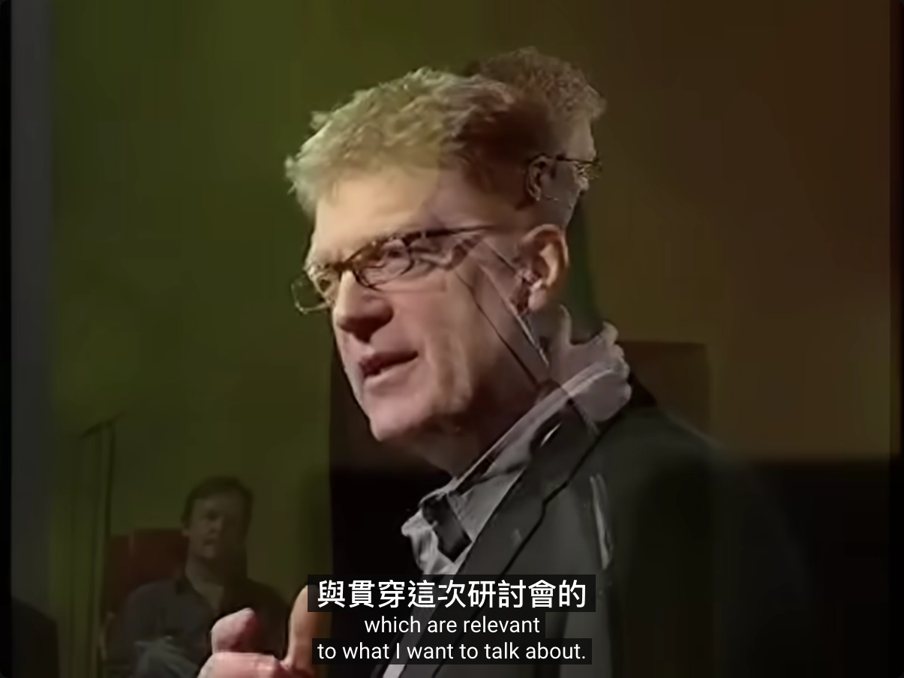
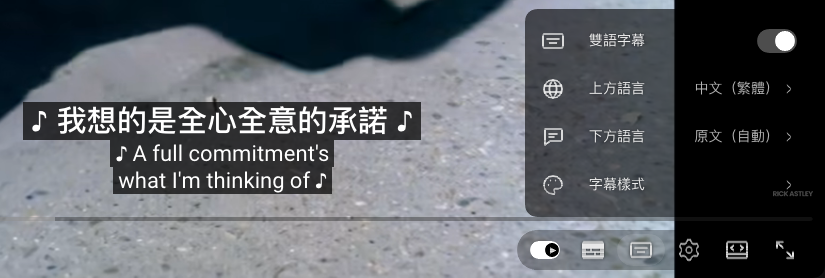

# YouTube Dual Subtitles

A userscript for bilingual YouTube captions in the style of old Hong Kong film subtitles. Your language sits on top as the larger line. The original language sits directly below as the smaller line. Both lines are centred together on a caption box. A video already in your language keeps YouTube's ordinary single line. All tracks come from YouTube itself: human tracks, or its own `tlang` translation. There is no external API, no key, and nothing to pay.



<sub>Frame from Ken Robinson, "Do schools kill creativity?" (TED, CC BY-NC-ND 4.0).</sub>



It was written to replace a closed-source dual-subtitle extension that hides YouTube's own caption container with a static style rule, so that whenever its renderer failed, no captions showed at all.

## Two rules the design keeps

- **It never hides the native captions.** The bottom line *is* YouTube's own caption. While the top line shows, the script restyles it (size, box, centred text). If this script breaks, you still have YouTube's captions.
- **It observes, it does not patch.** A `PerformanceObserver` sees the player's own `/api/timedtext` request. Nothing replaces `XMLHttpRequest` or `fetch`. The script then fetches the same URL with `lang`/`tlang` changed. Every other parameter is kept, because timedtext answers an empty body to a URL without the player's `pot` token (verified 2026-10-14: same URL minus `pot` → 0 bytes).

## Install

1. Install a userscript manager: [Tampermonkey](https://www.tampermonkey.net/) or [Violentmonkey](https://violentmonkey.github.io/). In Chrome 138 and later, also turn on **Allow user scripts** on the manager's page in `chrome://extensions`.
2. Open [yt-dual-subs.user.js](https://raw.githubusercontent.com/operonlab/userscripts/main/yt-dual-subs/yt-dual-subs.user.js) and accept the install. The manager checks for updates on its own.
3. Turn off any other dual-subtitle extension, then open a video and turn on CC. The two-bar button beside the CC button opens the settings.

Had a copy pasted in by hand before 0.5.0? Remove it: 0.5.0 has a new `@namespace`, so the manager installs it as a second script. Settings carry over.

## Settings

The menu looks like YouTube's own settings menu and follows its interface language: Chinese when YouTube's is, English otherwise. Arrow keys move through it and Escape goes back. Settings are kept in youtube.com's `localStorage` under `ytds-settings`.

| Setting | Default | Range |
|---|---|---|
| On | on | off = YouTube's ordinary captions, no track switching |
| Top language | the browser's (zh-TW → 繁體中文, zh-CN → 简体中文, else its primary subtag) | YouTube's translation languages for the video; five common ones first, the rest in your interface language's order, with search |
| Bottom language | original (auto) | original, or any translation language |
| Box colour / opacity | `#080808` / 75% | five swatches or any colour / 0–100% in steps of 25 |
| Gap | 0 px | 0–40 px |
| Top / bottom size | 4.4% / 3.2% of the player height | 2–8% |

`localStorage` on youtube.com is shared with every script on the site, so stored values are validated on load. Language codes, `#rrggbb` colours and finite numbers inside their range pass. Anything else falls back to the default, and unknown keys are dropped.

## Behaviour

The video's spoken language is the language of its auto-generated (`asr`) track. Without one, it is the track the player shows.

- **Top line source**, in order of preference:
  - a human track in the top language
  - for Chinese, a human track in the other script, converted
  - YouTube's translation of the bottom line's source track
- **Bottom line**:
  - With "original", it shows the original language: a human track if there is one, otherwise the auto-generated one. The right language in either kind counts as shown, so auto-generated captions a viewer picked are kept.
  - A regional code (`en-GB`) picks that exact track before any other `en` track.
  - With a chosen language, it shows that language's human track. If there is none, the player translates the original into it, using its own track object plus `translationLanguage`.
  - The script switches the player once per visit, retrying while the player is still settling. A track you pick by hand, during the retries or after, is left alone. If the player refuses all four requests, the top line translates whatever the bottom shows (`plan` ends in `(switch failed)`).
- **Single line** when the video is already in the top language (every Chinese counts as one language), when bottom and top are the same language, or when switched off.
- **Paired by the native cue.** A human top track has its own segmentation and timing. Read by the clock, it puts one sentence over another (「這一切都讓我太震驚。」 over "It's been great, hasn't it?"). So for each native cue on screen, the top line shows the top cue that overlaps it most, plus any top cue lying mostly inside it.
- **Auto-generated captions do not jump.** These tracks roll: in the Rick Astley asr translation, 83 of 100 cues overlap the next. Joining every cue on screen made the line cycle A / A+B / B, and fragments started with "。". The top line now shows only the newest cue and drops leading punctuation. A roll-up window is anchored as if it always held two lines, so the top line stays put while the English grows 1↔2 lines. The cost is one line of space while the English has one line. Measured live: 0 vertical moves, no joined or repeated lines.
- **Centred together.** With several caption windows on screen, the top line follows the lowest one, and it never leaves the player. Auto-generated captions roll up left-aligned inside a wide window, so while the top line shows, the native text is centred in its window and the top line is centred on that window.
- The top line hides when CC is off and while an ad plays. Caption requests for any video other than the one in the address bar are ignored: the video you just left, and hover previews.

Limits:
- `/watch` pages only (no Shorts, no embeds).
- The bottom line keeps YouTube's own line breaks.
- Translation quality is YouTube's. In one e2e run (2026-10-14) a whole track came back garbled.
- Without an `asr` track, nothing names the spoken language. A foreign video that opens on a top-language track is then taken for a video in that language.

Debug with `window.__ytdsState` in the console and `[yt-dual-subs]` warnings. `plan` names the top source, or `(no track list)` when the player's track list could not be read.

## Tests

```bash
node --test test/core.test.mjs test/load.test.mjs
# e2e: Python 3 (run on 3.12); fetch camoufox's browser once first: uv run --with camoufox==0.4.11 python -m camoufox fetch
uv run --with camoufox==0.4.11 --with playwright==1.59.0 test/e2e.py
# the same checks on the store extension in Chromium (any Chrome or Chromium executable)
YTDS_ENGINE=chrome-ext YTDS_CHROME=/path/to/chrome uv run --with camoufox==0.4.11 --with playwright==1.59.0 test/e2e.py
```

- `core.test.mjs` covers the plan (which track goes where, by setting), settings validation with garbage input, the URL rewrite, cue lookup (clock, newest-only, paired) and placement.
- `load.test.mjs` runs the loader in a fake page where fetch answers on cue. It covers retries, stale responses after navigation, a late track list, switching once with a dropped or hand-overridden switch, asr track objects, translated bottom lines, stored settings, and Chinese videos.
- `e2e.py` runs three live cases, in headless Camoufox by default or, with `YTDS_ENGINE=chrome-ext`, on the store extension in headless Chromium (built by `scripts/build-extension.sh` into a temp folder and loaded unpacked, so the bytes measured are the bytes the zip holds). The cases: Rick Astley (machine translation), a TED talk (human zh-TW track), and Rick Astley on its auto-generated English track. The script is injected into the watch page's HTML with the page's own CSP nonce, so it runs in the main world before any YouTube script, under the real CSP. The e2e checks:
  - each line is the right cue for its moment, against tracks the harness parses itself
  - pairing at the moments where it and the clock disagree
  - sizes, gap, boxes and centring
  - the asr case: one line at a time, never back, no leading punctuation, at most two vertical moves
  - the settings menu: open it from the button, set box colour and gap and see them on screen, check the language page lists no language twice and the rest in order, set Japanese on top and see kana, check the stored record, reset
- The e2e saves screenshots (the menu pages among them) to `test/shots/`, or to `$YTDS_SHOTS` if set. It exits `0` pass, `1` fail, `2` unverifiable (native captions never showed: bot check, ad, network). A `2` measured nothing, so it gets one retry with a fresh session.

What e2e does **not** cover:
- Tampermonkey's own injector (Camoufox mode injects the script into the HTML the way it does; chrome-ext mode measures the extension)
- a Chinese video
- SPA navigation between videos
- a second page load reading the stored settings: YouTube's service worker serves later page loads past the harness's injection; the load tests cover reading them

Chromium must not announce automation: with Playwright's default `--enable-automation`, `navigator.webdriver` is true and YouTube answers every caption request, the player's own included, with an empty body. The harness drops that flag.
